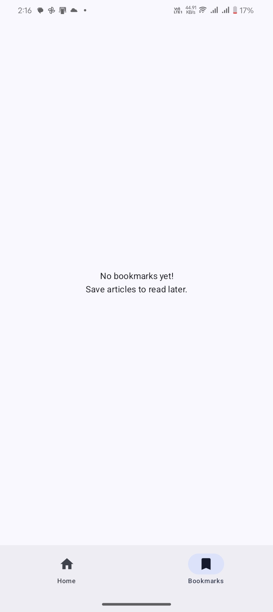

# NewsApp

An Android news reader built with Kotlin and Jetpack Compose. The project demonstrates a layered app structure with a NewsAPI client, Room persistence, bookmarks, and category navigation.

## Features

- Browse top headlines by category
- Save and remove bookmarked articles
- Cache articles locally with Room for offline access to saved content
- Open article details in an in-app WebView
- Compose UI with Navigation Compose and a ViewModel

## Tech

Kotlin, Jetpack Compose, Retrofit, OkHttp, Room, Hilt, Coroutines and Flow, Coil, and Navigation Compose.

## Screenshots

| Headlines | Bookmarks | Article |
| --- | --- | --- |
|  |  |  |

## Run locally

1. Clone this repository and open it in Android Studio.
2. Let Gradle sync, then run the `app` configuration on an Android device or emulator (minimum SDK 26).
3. The API client currently contains the placeholder `YOUR_API_KEY_HERE` in `NewsApi.kt`. Add a NewsAPI key for local development. Do not commit a personal key; this repository does not currently load it from a local secrets file.

## Project status

This is a sample app and starting point for further development. API availability and usage limits depend on the NewsAPI plan and selected region.

## License

No license file is currently included. Contact the repository owner before reusing or distributing this code.
